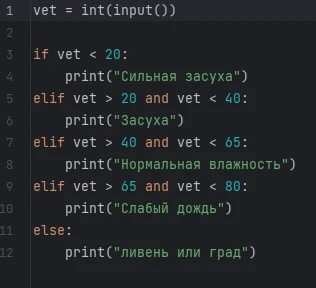
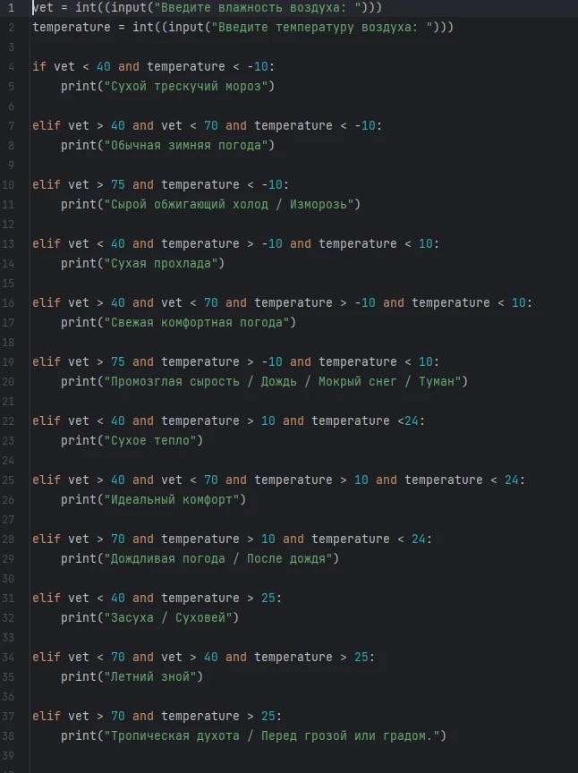
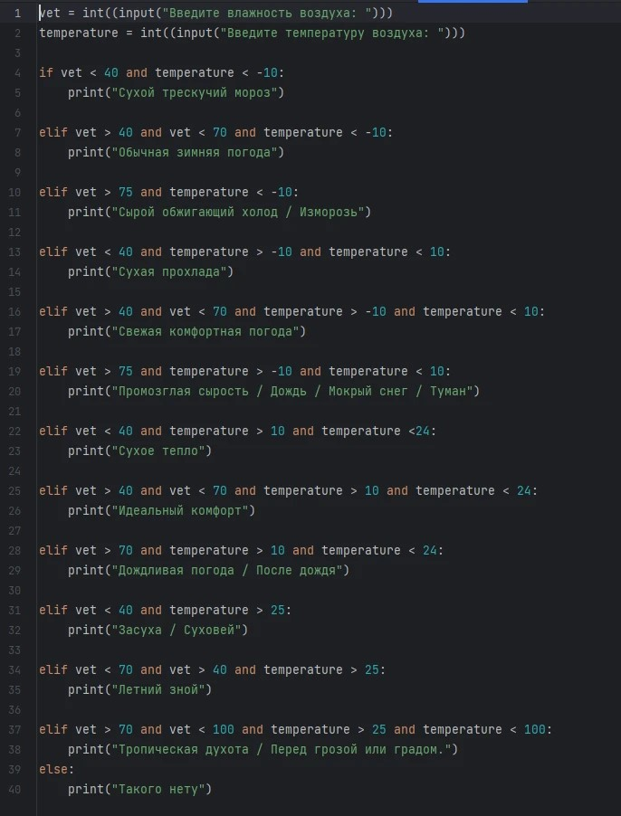

[Readme.md](https://github.com/user-attachments/files/34911799/Readme.md)
# Смирнов Леонид и Сартов Эржан

# Название вашего проекта: Погода
## О проекте
- 1)Зачем нужна программа? 
Это программа нужна для того чтобы понять пользователью на улице слишком жарко или идет дождь.
- 2)Что умеет программа какие особенности?
Программа умеет вывести градусы если мы зададим определенную температуру то выводит пользователью какая погода будет на улице
## Запуск
- Программа запускается с помощью консоли и выводит значение в терминале.

- Откройте консоль или терминал. В Windows нажмите Win + R, введите cmd и нажмите Enter. В macOS или Linux откройте стандартное приложение «Терминал».

- Передайте аргументы при необходимости. Если скрипт принимает параметры при запуске, допишите их через пробел после названия файла, например python script.py Ivan

## Команда
- Программист: Смирнов Леонид - пишет коды и разрабатывает программу
- Писатель: Сартов Эржан - записывает и составляет записи о проекте и замечания что делает программа и какие особенности.

## Помощь
Поддержка друг друга в проекте и изменения в проекте.

# СПРИНТ 1 (v1.py) План и первая версия
Скриншот работы:

## Состав блэклога:
- 1.Разработка программы
- 2.Анализ работы с проектом
- 3.Отчеты в программе
- 4.Замечания при изменении в проекте

## СПРИНТ 2 (v2.py)
## ИЗМЕНЕНИЯ:
- 1.Стало больше значений
- 2.Добавились изменения температур в проекте

Скриншо работы:

## СПРИНТ3 (v3.py)
Скриншот работы:

## Версия после запроса на изменение:
- 1. В программе нельзя вписать неправильные значения иначе такого нету в терминале.
- 2. Исправлены все техническое коды и проверены программистом. 
